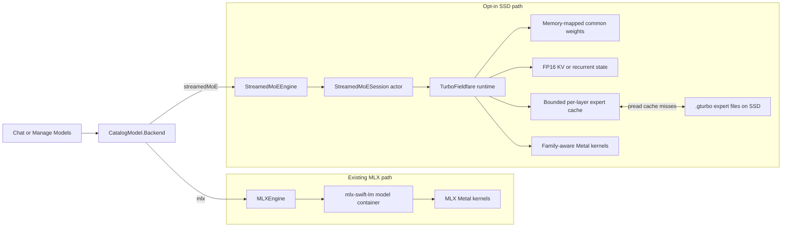
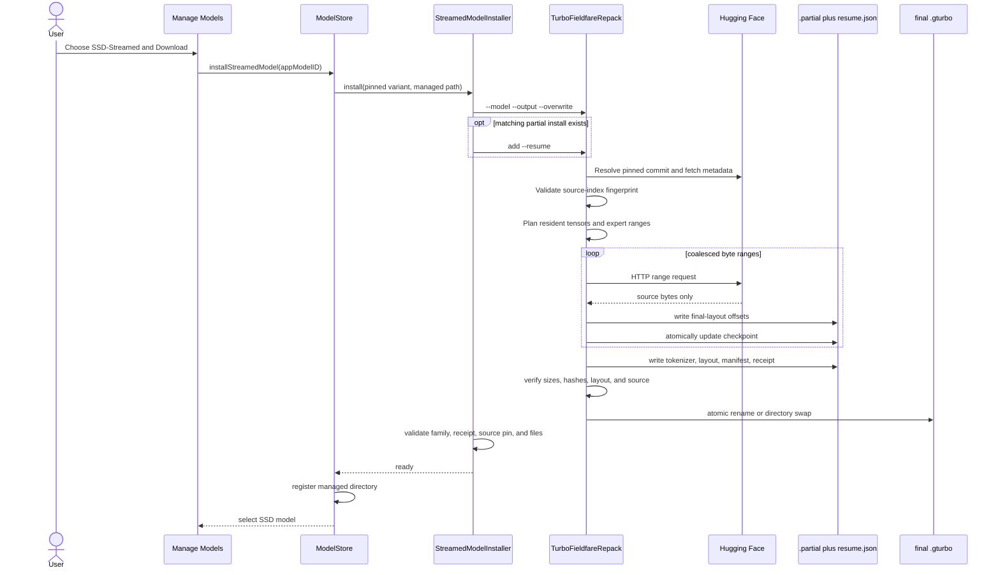
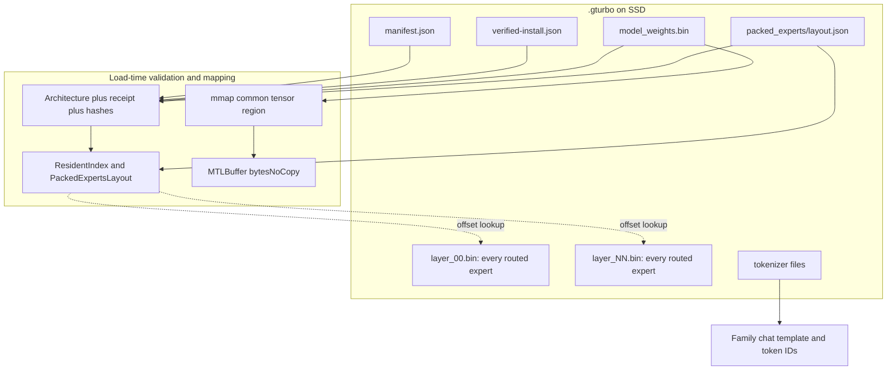
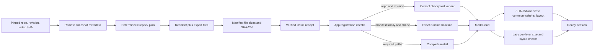
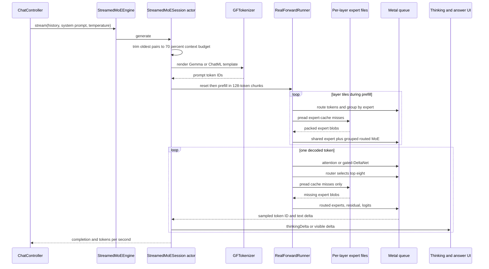
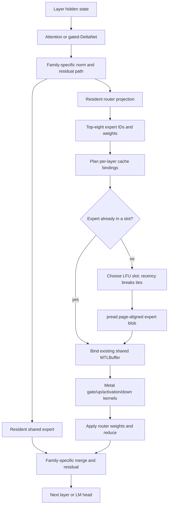
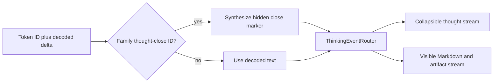
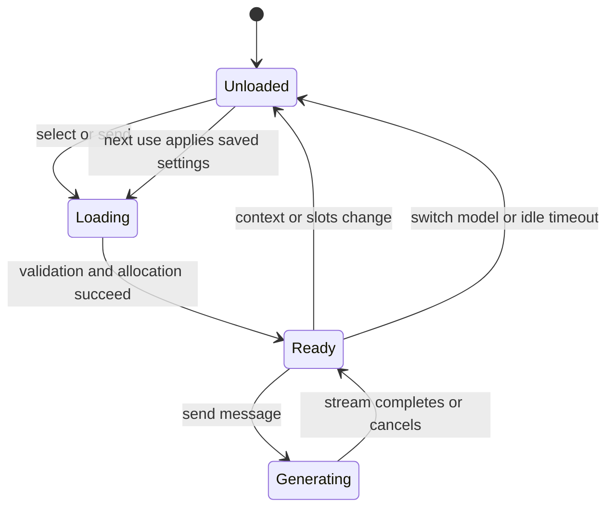
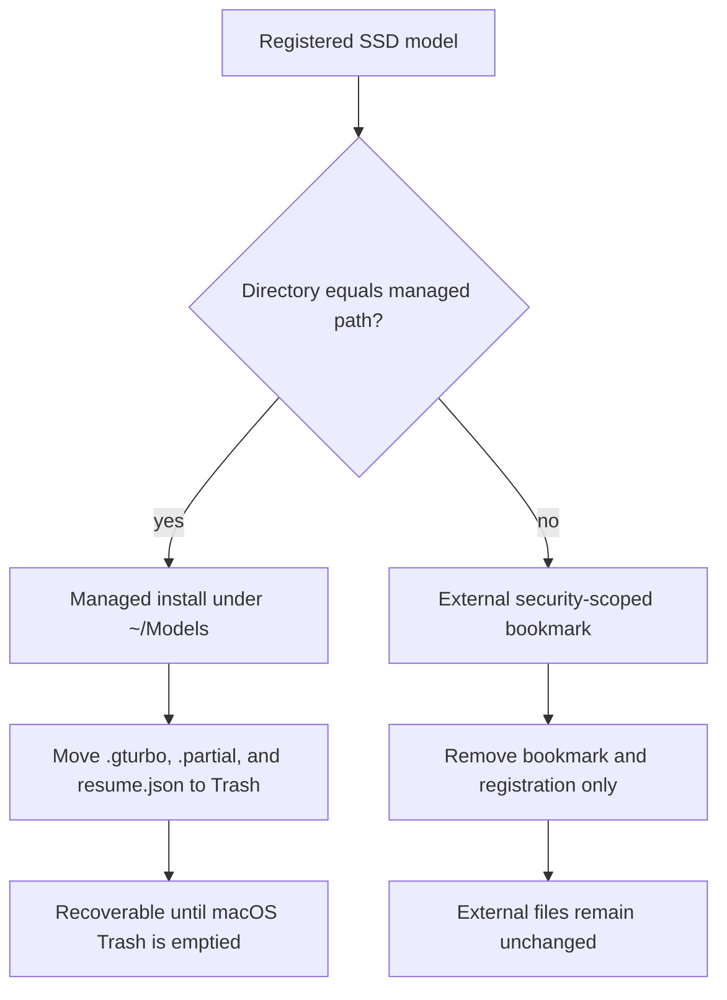

# SSD-streamed MoE architecture

MLX Chat has an opt-in backend for large mixture-of-experts (MoE) models that
do not need every routed expert in RAM at once. It vendors a pinned revision of
[TurboFieldfare](https://github.com/drumih/turbo-fieldfare), adds a native
installer and model-management flow, and keeps the normal MLX path separate.

This document describes the code in this repository. It covers the `.gturbo`
install format, direct remote repack, validation, model loading, Metal runtime,
expert streaming, context state, chat integration, and removal rules.

## Scope and design rules

The design follows five rules:

1. **MoE only.** Dense models and ordinary MLX MoE downloads still use
   `MLXEngine`. Backend choice is explicit in `CatalogModel.Backend`.
2. **No expert approximation.** The router selects the checkpoint's normal
   top eight experts. A cache miss causes an SSD read; it never causes the
   runtime to skip an expert or substitute a smaller network.
3. **Bounded runtime state.** Common weights are mapped once; context state,
   scratch buffers, and a fixed expert cache have explicit limits. The full
   routed-expert set stays in layer files on SSD.
4. **Pinned and verified installs.** Each supported checkpoint has a fixed
   repository, revision, source-index hash, architecture, app ID, and managed
   destination.
5. **Text-only streamed payloads.** The repacker leaves out vision and audio
   tensors. The matching standard MLX checkpoints keep their normal features.

These rules make the SSD backend a performance and memory choice, not a second
implementation of every MLX model.

## Supported checkpoints

| App label | Pinned source | Family | Layers | Routed experts per layer | Active per token | Approx. install |
| --- | --- | --- | ---: | ---: | ---: | ---: |
| Gemma 4 26B A4B | `mlx-community/gemma-4-26b-a4b-it-4bit` | Gemma 4 | 30 | 128 | 8 | 14.3 GB |
| Gemma 4 26B A4B QAT | `mlx-community/gemma-4-26B-A4B-it-qat-4bit` | Gemma 4 | 30 | 128 | 8 | 14.5 GB |
| Qwen3.6 35B A3B | `mlx-community/Qwen3.6-35B-A3B-4bit` | Qwen 3.6 | 40 | 256 | 8 | 19.5 GB |

`StreamedMoEInstall` owns the exact revisions and source-index hashes. The
standard MLX entry and its SSD entry have different app-local IDs and different
disk layouts, so both can be installed and selected at the same time.

## System boundary

`EngineRuntime` owns one local model slot. It chooses the backend from the
catalog entry; it does not infer the backend from a filename or model name.



The separation matters in three places:

- `ModelCatalog` exposes an SSD entry only for a pinned variant.
- `EngineRuntime` builds `MLXEngine` or `StreamedMoEEngine`, never both for the
  same selected entry.
- SSD setting changes unload only a loaded streamed engine. Dense MLX sessions
  and Apple Intelligence stay untouched.

## Install and repack pipeline

The app embeds the `TurboFieldfareRepack` executable as an auxiliary binary.
`StreamedModelInstaller` launches it directly; it does not open Terminal and it
does not download a full Hugging Face snapshot before repacking.



### Why direct repacking matters

A normal conversion often needs room for both the original safetensors files
and the converted model. `RemoteStreamingRepacker` instead:

- reads the remote model index and shard headers;
- calculates final destination offsets first;
- coalesces only the source byte ranges needed by the text runtime;
- writes those ranges into pre-sized resident and per-layer expert files;
- keeps bounded copy scratch rather than whole checkpoint buffers; and
- publishes the install only after the manifest and receipt are complete.

The output is not a second copy made after a 14–20 GB source download. It is the
first complete local payload.

### Resume and cancellation

An interrupted managed install keeps two sidecars beside the final path:

```text
<Model>.gturbo.partial/     # final-layout bytes completed so far
<Model>.gturbo.resume.json  # pinned source, plan fingerprint, completed ranges
```

The app polls the checkpoint every 500 ms for progress. A later attempt resumes
only when the repository, revision, source index, copy plan, partial directory,
and checkpoint still agree. Final publication uses a rename, so the runtime
does not open a half-built directory.

## The `.gturbo` disk layout

```text
<Model>.gturbo/
├── manifest.json
├── verified-install.json
├── model_weights.bin
├── tokenizer/
│   ├── config.json
│   ├── tokenizer.json
│   ├── tokenizer_config.json
│   └── chat_template.jinja
└── packed_experts/
    ├── layout.json
    ├── layer_00.bin
    ├── layer_01.bin
    └── ... one packed file per transformer layer
```

The files have distinct jobs:

- `model_weights.bin` contains the embedding, attention projections, router,
  shared expert, norms, output head, and family-specific common tensors. It has
  an index followed by a page-aligned tensor region.
- `packed_experts/layer_NN.bin` contains every routed expert for one layer.
  Each expert is a fixed, page-aligned blob with its gate, up, down, scale, and
  bias data.
- `layout.json` maps `(layer, expert)` to the physical byte offset and the
  offsets of that expert's subtensors.
- `manifest.json` binds the architecture, quantization contract, flags, file
  sizes, and hashes.
- `verified-install.json` binds the completed file set and manifest to the
  source repository, pinned revision, and final directory.



The resident file is about 1.3–1.6 GB for the current packed checkpoints. It is
mapped with `MAP_PRIVATE`, wrapped in a shared Metal buffer without copying,
and advised for random access. macOS decides which mapped pages and SSD reads
remain physically resident, so virtual size, process resident size, and system
file cache will not report the same number.

## What stays in RAM

The streamed session owns:

- the memory-mapped common model weights;
- Metal pipelines and fixed inference scratch;
- the tokenizer and generation scratch;
- an FP16 K/V cache for softmax-attention layers;
- Qwen's fixed recurrent state for gated-DeltaNet layers; and
- a fixed expert-slot cache for every routed layer once that layer opens.

The full set of routed experts stays on SSD. Normal generation touches every
layer, so all per-layer streamers and their slots will normally exist after the
first complete prefill or decoded token.

### Context memory

The Context control sets the runtime's maximum token position and the capacity
of full-attention K/V buffers. Gemma uses an FP16 ring for its 25 sliding-window
layers, capped at `1024 + 128` tokens, while its five full-attention layers grow
with the selected context. Qwen has ten full-attention layers; its other thirty
layers use fixed gated-DeltaNet state instead of per-token K/V rows.

Approximate K-plus-V allocation from the current architecture constants is:

| Context | Gemma FP16 K/V | Qwen FP16 K/V |
| ---: | ---: | ---: |
| 4K | 305 MiB | 80 MiB |
| 8K | 385 MiB | 160 MiB |
| 16K | 545 MiB | 320 MiB |
| 32K | 865 MiB | 640 MiB |

Qwen also allocates about 61 MiB of fixed FP32 delta-rule and FP16 convolution
state across its thirty linear-attention layers. These figures omit common
weights, expert slots, scratch, tokenizer data, app memory, and the macOS file
cache. Buffers are allocated for the configured capacity, while physical pages
become resident as the runtime writes them.

### Expert-cache memory

The Expert cache value is a slot count **per layer**, not one global pool. A
slot is exactly one packed expert blob for that family. The current runtime uses
LFU eviction with recency as a tie-breaker.

Once all layers are open, the main expert-slot allocation is:

```text
layer count × slots per layer × page-aligned expert stride
```

| Slots | Gemma, 30 × 3,358,720-byte experts | Qwen, 40 × 1,769,472-byte experts |
| ---: | ---: | ---: |
| 8 | about 769 MiB | about 540 MiB |
| 16 | about 1.50 GiB | about 1.05 GiB |
| 24 | about 2.25 GiB | about 1.58 GiB |
| 32 | about 3.00 GiB | about 2.11 GiB |

Each slot uses 2 MiB-aligned CPU memory wrapped by a shared `MTLBuffer` with
`bytesNoCopy`. `pread` writes cache misses straight into that storage. Increasing
slots can improve repeat hits and lower SSD traffic; it cannot make the model
choose more than eight experts or change their weights.

## Load path and trust checks

The app treats the helper-produced receipt as a trust boundary, but still
checks the install at registration and load.



The loader rejects unknown manifest flags, removed quantization modes,
unsupported quantization slots, non-page-aligned expert strides, missing layer
files, family mismatches, and any architecture field that differs from the
compiled Gemma or Qwen baseline. A registered external folder must pass the
same checks as a managed install.

## Runtime construction

`StreamedMoESession.load` builds the runtime in this order:

1. Validate the selected `.gturbo` against its app variant.
2. Create `MetalContext` and load the bundled Metal library.
3. Load the tokenizer from local sidecars.
4. Build `RuntimeConfiguration` with the chosen expert slots, LFU caching,
   chunked prefill, 128-token chunks, preferred full-attention prefill, disabled
   `RDADVISE`, and a logits head for sampling.
5. Load `Model` with a `pread` expert streamer and trusted-receipt policy.
6. Create `RealForwardRunner` with the chosen maximum context.
7. Allocate reusable logits, probability, output-token, and sampler scratch.

`StreamedMoESession` is an actor because Metal buffers, cache slots, runner
state, and detokenization state must have one serial owner. `StreamedMoEEngine`
also keeps one in-flight load task so model warming and first-send cannot load
the model twice.

## Prompt, prefill, and decode

Each turn follows this flow:



### Prompt handling

- Gemma thinking prompts use the Gemma turn format and open the model's thought
  channel before generation.
- Qwen thinking prompts use ChatML and open `<think>` before generation.
- With thinking off, TurboFieldfare's family chat template renders the prompt.
- `PromptBuilder` estimates four characters per token and retains the newest
  messages inside 70% of the selected context, always keeping the pending user
  message.
- Generation reserves the unused context and caps a response at 8,192 tokens.

The runner resets context state and re-prefills the retained multi-turn history
for each app turn. The expert cache stays warm while the streamed engine remains
loaded, so later turns can still benefit from prior expert hits.

### Chunked prefill

Prefill processes at most 128 prompt tokens per chunk. It routes all rows,
groups token/expert pairs by physical expert offset, and schedules small expert
tiles within the configured slot budget. Shared-expert work and routed tiles use
separate Metal command buffers; fetched slots remain reserved until commands
that reference them finish. This avoids overwriting a slot while the GPU still
reads it.

### Per-token routed expert flow



Cache misses for one plan are read concurrently. A read or validation failure
ends generation with an error; the runtime does not silently compute with
missing experts.

## Family-specific execution

The `.gturbo` manifest carries a family value and a full architecture record.
`RealForwardRunner` selects kernels and tensor-name rules from that record.

### Gemma 4 26B-A4B

- 30 layers: 25 sliding-window and 5 full-attention layers.
- 128 routed experts per layer, top eight per token.
- Tied embedding/output head.
- Gemma's scaled router and per-expert scales.
- Parallel shared and routed FFN branches with the Gemma norm sandwich and
  per-layer residual scalar.
- Gemma thought-channel token handling.

The standard and QAT checkpoints share this graph but keep separate source
pins, receipts, install folders, app IDs, and weights.

### Qwen3.6 35B-A3B

- 40 layers: 30 gated-DeltaNet linear-attention and 10 full-attention layers.
- 256 routed experts per layer, top eight per token.
- Fixed recurrent state for linear-attention layers.
- Untied output head, gated attention output, NeoX-style partial RoPE, SwiGLU,
  and a sigmoid-gated shared expert.
- ChatML and `<think>...</think>` stream handling.

The family dispatch is data-driven after load, but support is not open-ended:
the manifest must match one of the compiled architecture baselines.

## Thinking and visible output

TurboFieldfare's detokenizer removes special-token text. Gemma's thought-channel
close and Qwen's `</think>` can therefore arrive as a token ID with an empty text
delta. `StreamedMoEEventRouter` watches the family-specific close-token ID,
synthesizes the marker for the shared thinking filter, and emits separate
`thinkingDelta` and visible `delta` events.



Keeping the split at the engine event boundary prevents thought text from being
mixed into Markdown, code fences, HTML artifacts, or the saved answer.

## Settings and their effect

The SSD setup sheet exposes two global settings for all streamed variants:

| Control | Values | Main effect | Can affect answer content? |
| --- | --- | --- | --- |
| Context | 4K, 8K, 16K, 32K | K/V or recurrent-state limit and retained chat history | Yes, when a smaller value trims older history or leaves less output room |
| Expert cache | 8, 16, 24, 32 slots per layer | Expert RAM and SSD cache-hit rate | No; the same selected experts and weights run |

Defaults are 4K context and 16 slots. The controls persist in `UserDefaults`
and are independent of each other. They are disabled while a response streams.
When either value changes while idle, `EngineRuntime` unloads only a resident
streamed engine; the next load builds new buffers with the new values and the
next turn prefills the retained conversation again. There is no mid-token or
mid-response cache resize.



The best setting depends on available RAM, SSD speed, prompt size, and expert
reuse. More slots are useful when RAM is available and SSD reads limit token
speed. A larger context is useful only when the conversation needs it; it does
not make a short prompt more capable.

## Model ownership and removal

MLX Chat distinguishes app-managed data from an external folder selected by the
user.



Managed artifacts appear in Manage Models even if registration state was lost,
so an orphaned multi-gigabyte install can still be found and removed. Sidecars
move before the completed directory, which leaves a valid model intact if an
earlier Trash operation fails.

## Vision boundary

The source Gemma and Qwen checkpoints may include vision tensors, but
`RepackPlanner` classifies `vision_tower.*`, `embed_vision.*`, and
`audio_tower.*` as excluded multimodal data. The runtime has no image encoder,
multimodal projector, image-token prompt path, or Metal kernels for these
tensors. As a result:

- the SSD variants advertise `supportsVision == false`;
- image input is intentionally unavailable on this backend; and
- the standard MLX copies remain the choice for vision.

This is a layout and runtime boundary, not a defect in the model checkpoint.

## Concurrency and lifecycle

- `EngineRuntime` keeps one local model backend in RAM at a time.
- `StreamedMoEEngine` joins concurrent load callers through one load task.
- `StreamedMoESession` serializes access to non-copyable Metal and streamer
  state.
- Stream termination cancels the generation task.
- Model switching and idle auto-unload release the session, mapped buffer,
  expert streamers, cache slots, K/V buffers, recurrent state, and scratch.
- A settings change never unloads an active generation.

The macOS file cache may retain recently read expert pages after the process
releases its own buffers. That memory remains reclaimable by the operating
system and should not be treated as a leaked model allocation.

## Source map

| Concern | Main implementation |
| --- | --- |
| Supported variants and settings | [`StreamedMoEInstall.swift`](MLXChat/Models/StreamedMoEInstall.swift) |
| Bundled helper process and progress | [`StreamedModelInstaller.swift`](MLXChat/Models/StreamedModelInstaller.swift) |
| Registration, bookmarks, managed storage, removal | [`ModelStore.swift`](MLXChat/Models/ModelStore.swift) |
| App engine and prompt/output bridge | [`StreamedMoEEngine.swift`](MLXChat/Engine/StreamedMoEEngine.swift) |
| One-model runtime lifecycle | [`EngineRuntime.swift`](MLXChat/Engine/EngineRuntime.swift) |
| SSD setup controls | [`ModelDownloadOptionsSheet.swift`](MLXChat/Views/Settings/ModelDownloadOptionsSheet.swift) |
| Runtime configuration | [`RuntimeConfiguration.swift`](Vendor/TurboFieldfare/Sources/TurboFieldfare/Runtime/Configuration/RuntimeConfiguration.swift) |
| Manifest and resident model loading | [`Infrastructure/ModelIO`](Vendor/TurboFieldfare/Sources/TurboFieldfare/Infrastructure/ModelIO) and [`Model.swift`](Vendor/TurboFieldfare/Sources/TurboFieldfare/Runtime/Inference/Model.swift) |
| Expert cache and `pread` | [`PreadExpertStreamer.swift`](Vendor/TurboFieldfare/Sources/TurboFieldfare/Infrastructure/Streaming/PreadExpertStreamer.swift) |
| Prefill and token decode | [`RealForwardRunner.swift`](Vendor/TurboFieldfare/Sources/TurboFieldfare/Runtime/Inference/RealForwardRunner.swift) |
| FP16 K/V and Qwen recurrent state | [`Runtime/KVCache`](Vendor/TurboFieldfare/Sources/TurboFieldfare/Runtime/KVCache) |
| Remote direct repack | [`RemoteStreamingRepacker.swift`](Vendor/TurboFieldfare/Sources/TurboFieldfareRepack/Core/Remote/RemoteStreamingRepacker.swift) |
| Tensor partition and vision exclusion | [`RepackPlanner.swift`](Vendor/TurboFieldfare/Sources/TurboFieldfareRepack/Core/Planning/RepackPlanner.swift) |

## Tests and change safety

App regressions live in `Tests/MLXChatTests/StreamedMoETests.swift`. They cover
setting validation, variant separation, installer embedding, resume progress,
managed versus external removal, family prompt templates, and thought/answer
routing. TurboFieldfare's package tests cover source selection, repack planning,
format validation, expert streaming, family kernels, prefill, decode, and Qwen
runtime behavior.

When adding a checkpoint or family, do not make it appear by name alone. Add or
update all of the following as one change:

1. a pinned source and source-index fingerprint;
2. a compiled architecture baseline and manifest checks;
3. a deterministic tensor classification and packed layout;
4. every family-specific resident accessor and Metal graph branch;
5. tokenizer, prompt, stop-token, and thinking rules;
6. app catalog identity, install destination, and validation binding; and
7. real-model acceptance tests plus app regression tests.

For setup and current user-facing limits, see
[docs/STREAMED_MOE.md](docs/STREAMED_MOE.md). For the exact vendored source
baseline, see
[Vendor/TurboFieldfare/MLXCHAT_PATCH.md](Vendor/TurboFieldfare/MLXCHAT_PATCH.md).
