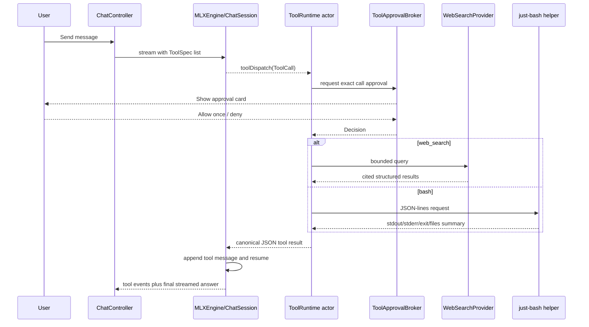

# Agent Tools Implementation Plan

Status: planned, not implemented. This document is the handoff for the next
implementation session.

## Outcome

Add safe tool use to MLX Chat's explicitly tool-capable local models. The first
release should support:

- web search with cited results;
- a simulated Bash environment backed by a virtual filesystem;
- per-call approval before any tool runs;
- visible, persistent tool-call and tool-result cards in the transcript;
- a bounded model → tool → model loop that can be stopped at any time.

Do not expose `/bin/bash`, the user's home directory, or arbitrary network access.

## What already exists

The app currently has one turn coordinator in
`MLXChat/App/ChatController.swift`. It creates the pending assistant
`ChatMessage`, converts stored messages to `[EngineMessage]`, consumes
`EngineEvent`, buffers streamed thinking/content, and finalizes the turn.

`MLXChat/Engine/MLXEngine.swift` uses MLX Swift LM 3.31.4 `ChatSession` and
`streamDetails`. It currently discards `.toolCall` events. Do not build an LFM
parser from scratch: MLX Swift LM already supplies all of these pieces:

- `ToolSpec` and `ToolCall`;
- `ToolCallFormat.lfm2` for LFM2/LFM2.5's Python-like tool syntax;
- parsers for JSON, Qwen/XML, Gemma, Llama 3, Mistral, and other formats;
- `ChatSession.tools` and `ChatSession.toolDispatch`;
- an internal restart loop that appends each tool result as a tool message and
  resumes generation.

The relevant package sources are under the resolved Swift package checkout:

- `Libraries/MLXLMCommon/Tool/ToolCall.swift`
- `Libraries/MLXLMCommon/Tool/ToolCallFormat.swift`
- `Libraries/MLXLMCommon/ChatSession.swift`

`MLXEngine` already receives `.toolCall` from `streamDetails`, but the current
switch ignores it. The implementation should use `toolDispatch` so ChatSession
owns prompt-format-specific result insertion and continuation.

The SwiftData schema currently contains only `Conversation` and `ChatMessage`,
registered in `MLXChat/App/MLXChatApp.swift`. Any persistent tool model must be
added there and migration-tested.

## Scope decisions

### First supported engines

Start with MLX models whose catalog entries explicitly opt in to tool use.
LFM2.5 should use `.lfm2`. Add a catalog capability rather than treating every
model with a known parser as reliable:

```swift
struct ToolCapability: Codable, Hashable {
    let format: ToolCallFormatName
    let allowedTools: Set<ToolName>
}
```

Keep Apple Intelligence and `StreamedMoEEngine` out of the first pass. Their
generation APIs and prompt paths need separate adapters. Imported models should
default to tools disabled until a known capability upgrade or an advanced user
setting explicitly enables a tested format.

### Bash runtime

Use [`just-bash`](https://github.com/vercel-labs/just-bash/tree/main/packages/just-bash),
not `@cloudflare/shell`. `just-bash` implements Bash syntax over virtual
filesystems; Cloudflare's package runs JavaScript and targets Workers rather
than a native macOS app.

The checked package version at planning time is `just-bash` 3.2.0,
Apache-2.0, requiring Node 20.18.1 or later. Pin the exact version and record it
in `THIRD_PARTY_NOTICES.md`.

Do a packaging spike before app integration. The helper must ship as one
signed, hardened-runtime-compatible executable inside the app bundle and must
not depend on a user's Node installation. Compare:

1. a bundled Node Single Executable Application; and
2. a Bun-compiled executable, only if the full just-bash test fixture works.

The spike must prove arm64 execution, WASM/resource loading, cancellation,
notarization, and JSON-lines stdin/stdout. Pick the smaller reliable option and
document the build command in `project.yml` or a checked-in build script.

### Web search provider

Keep the app-side contract provider-neutral. Define `WebSearchProvider` and a
fake provider first. The production provider must expose a supported JSON API,
not scraped search-result HTML. Store its API key in Keychain, never
`UserDefaults`, prompts, tool results, logs, or the helper environment.

If no provider is configured, the tool should return a typed `notConfigured`
result and the settings UI should explain how to enable it. Selecting and
paying for a provider remains a product decision; it must not block the core
loop or tests.

## Target architecture



## Proposed modules

Create these files with small protocol-backed types:

### `MLXChat/Tools/ToolTypes.swift`

- `ToolName`: initially `webSearch` and `bash`.
- `ToolInvocation`: stable ID, name, typed arguments, model ID, conversation ID.
- `ToolExecutionResult`: success flag, summary, structured payload, error,
  duration, truncation flags.
- `ToolEvent`: requested, awaitingApproval, running, completed, denied, failed.
- `ToolPolicy`: limits and approval requirements.

All tool results returned to the model must use one bounded JSON envelope. Do
not feed raw Swift errors or unbounded stdout back into the context.

### `MLXChat/Tools/ToolRegistry.swift`

- Own the MLX `ToolSpec` definitions.
- Validate the decoded arguments a second time after MLX parsing.
- Reject unknown tools and unknown fields.
- Provide deterministic schemas used by unit tests and prompt fixtures.

Initial schemas:

- `web_search(query: String, max_results: Int?)`
- `bash(script: String)`

Do not add a generic URL fetch, host filesystem, process launch, or arbitrary
HTTP tool in the first release.

### `MLXChat/Tools/ToolRuntime.swift`

Implement as an actor. Responsibilities:

- enforce a maximum of 6 tool calls per user turn;
- permit only one tool call at a time initially;
- request approval for every call;
- execute with a 15-second web timeout and 10-second Bash timeout;
- cap model-visible output at 32 KiB per result;
- emit `ToolEvent` updates to the engine/UI;
- redact configured secrets before persistence or model return;
- map cancellation to a stable cancelled result and stop the helper.

The runtime must not import SwiftUI.

### `MLXChat/Tools/ToolApprovalBroker.swift`

Use an actor with checked continuations and one observable MainActor-facing
state object. Each request must resolve exactly once on allow, deny, turn
cancellation, conversation deletion, or app termination.

First UI choices:

- **Allow once**
- **Deny**

Do not add “Always allow” until scope rules and revocation settings exist.

### `MLXChat/Tools/WebSearchProvider.swift`

Return `WebSearchResult` values containing title, URL, snippet, and optional
published date. Requirements:

- HTTPS only;
- query and result-count limits;
- no redirects to non-HTTPS URLs;
- no cookies or ambient browser credentials;
- source URLs preserved for citations;
- response-size limit before JSON decoding;
- test with `URLProtocol`, never the live API in the normal suite.

The tool result should contain data, not a prose answer. The model composes the
answer and citations.

### `Tools/just-bash-helper/`

The helper owns the JavaScript dependency and exposes JSON-lines messages:

```json
{"id":"call_123","script":"printf '%s\\n' hello","limits":{"timeout_ms":10000}}
```

Response:

```json
{"id":"call_123","exit_code":0,"stdout":"hello\\n","stderr":"","timed_out":false,"truncated":false}
```

Initial sandbox:

- `InMemoryFs` only;
- no host mounts;
- network disabled;
- fixed working directory `/workspace`;
- clean environment with no host variables;
- no custom trusted commands;
- aggregate filesystem cap 64 MiB;
- stdout and stderr cap 1 MiB each inside the helper, then 32 KiB when returned
  to the model;
- disable or reject `rm` and `rmdir` for the first release even though the
  virtual filesystem is disposable.

Terminate the whole helper process on timeout or cancellation. Cooperative
JavaScript cancellation alone is not a hard boundary.

### `MLXChat/Tools/JustBashClient.swift`

- Locate the signed helper through `Bundle.main`.
- Start one process per approved call in the first version.
- Use pipes only for JSON-lines input/output.
- never invoke a shell to launch it;
- reject malformed, mismatched-ID, oversized, or trailing output;
- terminate on cancellation and await process exit;
- surface a typed “helper unavailable” result in source builds where it is not
  bundled.

### Persistence and transcript UI

Add a SwiftData `ToolActivity` model related to the assistant `ChatMessage`:

- stable call ID;
- tool name;
- redacted arguments preview;
- state;
- redacted result summary;
- timestamps and duration;
- approval decision;
- error code, not raw secret-bearing errors.

Register it in `MLXChatApp.modelContainer`. Add a migration test using an old
store fixture before shipping.

Create `ToolActivityCard` under `MLXChat/Views/`. It should appear inside the
assistant turn and show requested/running/completed/denied/failed states. Keep
large stdout collapsed. Provide accessibility labels and stable identifiers.

Approval should be an inline card near the active assistant message, not a
blocking `NSAlert`, so Stop, transcript scrolling, and accessibility remain
usable.

## Engine integration

Extend `EngineEvent` with tool lifecycle events or a single
`case toolEvent(ToolEvent)`. Extend `EngineMessage` only if the app needs to
rebuild a ChatSession from persisted tool messages; prefer letting ChatSession
own tool messages within an active session.

In `MLXEngine`:

1. build `ChatSession` with the catalog model's tested `[ToolSpec]`;
2. provide a `toolDispatch` closure that calls `ToolRuntime`;
3. forward runtime events through the same `AsyncThrowingStream` continuation;
4. return the canonical JSON result string from `toolDispatch`;
5. let ChatSession append the tool result and restart generation;
6. preserve the existing thinking filter only for text chunks;
7. count one completed user/assistant turn only after the final answer, not
   after an intermediate tool call;
8. cancel the tool runtime/helper when the stream terminates.

In `ChatController`:

- persist each tool event against `activeMessage`;
- keep `isStreaming` true while approval or a tool is pending;
- make Stop deny/cancel outstanding approval and terminate execution;
- ensure Retry starts a clean tool budget;
- prevent model switching and conversation deletion from leaving continuations
  or helper processes alive;
- show tool errors in the tool card while still returning a safe error result
  to the model, allowing it to answer without the tool.

## Delivery phases

### Phase 0 — dependency and model fixtures

- Pin just-bash and complete the standalone-helper packaging spike.
- Add representative LFM2.5 and second supported-model tool-call fixtures.
- Confirm MLX Swift detects the intended format from each downloaded config.
- Add `supportsTools`/format metadata to `CatalogModel` with backward-compatible
  Codable defaults.

Exit: helper executes a deterministic virtual command and both model fixtures
parse into the expected `ToolCall` without any app UI.

### Phase 1 — typed runtime and fake tools

- Add ToolTypes, ToolRegistry, ToolRuntime, and ApprovalBroker.
- Integrate ChatSession tools/toolDispatch using fake executors.
- Add max-call, timeout, cancellation, malformed-argument, denial, and output
  truncation tests.

Exit: an engine integration fixture completes model → fake tool → final answer.

### Phase 2 — approval and transcript UI

- Add ToolActivity persistence and migration coverage.
- Render inline cards and approval controls.
- Wire Stop, Retry, regeneration, and conversation deletion.
- Add deterministic debug launch seams for UI tests.

Exit: UI tests cover allow, deny, running, success, failure, and cancellation.

### Phase 3 — web search

- Add provider settings and Keychain secret storage.
- Implement one provider behind `WebSearchProvider`.
- Add URLProtocol response, timeout, oversize, invalid URL, and redaction tests.
- Render source links in the result card and require the final answer to retain
  source URLs.

Exit: an opt-in live smoke test performs one search and produces a cited answer;
the normal suite remains offline.

### Phase 4 — just-bash

- Bundle and sign the helper.
- Add JustBashClient and process cancellation.
- Verify no host filesystem or network access.
- Add scripts for pipes, redirects, loops, `rg`, `jq`, timeout, output limits,
  filesystem limits, malformed protocol, and killed-helper recovery.

Exit: an opt-in model smoke test chooses Bash, receives a structured result,
and completes its answer. Notarization and `codesign --verify --deep --strict`
must pass with the helper embedded.

### Phase 5 — hardening and release

- Run prompt-injection tests where search snippets request hidden actions.
- Verify tools cannot see Keychain values, host environment, home files, or
  browser sessions.
- Add per-turn audit logging with secret redaction.
- Update README, privacy copy, entitlements review, third-party notices, and
  release notes.
- Run real inference on every catalog model that claims tool support.

Exit: all security, unit, integration, UI, model, signing, notarization, and
Sparkle update checks pass.

## Required test matrix

### Unit

- schema stability and backward decoding;
- tool name/argument validation;
- LFM2.5 parser fixtures;
- approval continuation resolves once;
- call-count, timeout, output, and result-size limits;
- redaction of API keys and authorization headers;
- canonical JSON result encoding;
- helper protocol and process lifecycle.

### Integration

- model requests a fake tool and then answers;
- denial becomes a tool result and the model still answers;
- Stop during approval and execution;
- tool error and malformed model arguments;
- session rebuild after regeneration;
- opt-in live web search;
- opt-in real LFM2.5 web and Bash calls.

### UI

- approval card contents and accessibility;
- Allow once and Deny;
- running/success/failure/cancelled cards;
- collapsed large output;
- conversation deletion while approval is open;
- restart restores completed cards but no pending execution.

### Release security

- `codesign --verify --deep --strict` includes the helper;
- Gatekeeper and notarization pass;
- helper cannot read a seeded host-only file;
- helper network attempt fails;
- app API secret never appears in process arguments, environment, logs,
  transcript persistence, or model-visible output.

## Open decisions for the next session

Resolve these before production web work, but they do not block Phases 0–2:

1. Which paid/supported web-search API should ship first?
2. Should web search require approval on every call, or may users later grant a
   revocable per-conversation read-only permission?
3. Which second catalog model is formally guaranteed and smoke-tested for tool
   use alongside LFM2.5?
4. Node SEA or Bun for the signed just-bash helper, based on the packaging spike?
5. Should a later release offer a user-selected read-only mount? It must remain
   out of the first release.

## First commands/checks for the next session

1. Run the repository Fable preflight required by `AGENTS.md`.
2. Refresh the index with `ccc index`.
3. Inspect the exact resolved MLX Swift LM version and the `ChatSession`
   tool-dispatch implementation before changing engine APIs.
4. Confirm the working tree and current release state; do not mix tool work with
   an unfinished release.
5. Begin Phase 0 with fixtures and the standalone-helper spike, not UI work.
